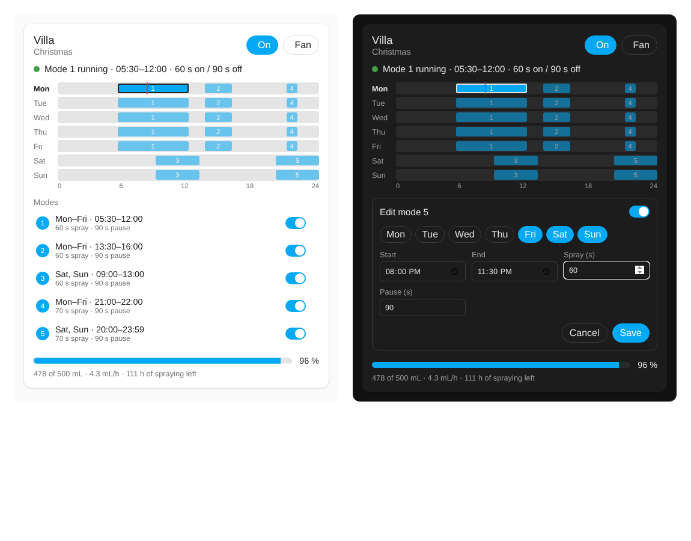

# Hotel Collection for Home Assistant

*Created with Claude.ai.*

Local, cloud-free Home Assistant control of **Hotel Collection** scent diffusers —
verified on the **Villa 2.0** — that pair with the *ScentArea* app.

The diffuser keeps a plain TCP control port open on your network (**8080**).
This integration talks to that port directly: no cloud, no account, and the
ScentArea app keeps working alongside it.

Other white-label diffusers that use the ScentArea app (for example some
Aroma360 2.0 models) likely speak the same protocol but are untested.

## What you get

| Entity | Type | Notes |
|---|---|---|
| Power | switch | Instant; changes made in the app show up immediately |
| Fan | switch | |
| Child lock | switch (config) | |
| Oil remaining | sensor, mL | From the device |
| Oil level | sensor, % | Remaining ÷ bottle size |
| Bottle size | sensor, mL (diagnostic) | |
| Consumption rate | sensor, mL/h | mL used per hour of *spraying* — a calibration value for the oil gauge, not a strength setting |
| Spraying time left | sensor, h | Remaining ÷ rate — hours of spraying, not calendar time |
| Oil days left | sensor, days | The diffuser's own estimate at the current schedule |
| Consumption rate setting | number, mL/h | Edit to calibrate the gauge (0.1–25.5) |
| Oil remaining setting | number, mL | Correct the level after measuring the bottle |
| Bottle size setting | number, mL (config) | |
| Oil refilled | button | Sets oil remaining to the bottle size |
| Active schedule slots | sensor | Full slot list (days, times, work/pause) in attributes |
| Device clock | sensor (diagnostic, off by default) | |
| Scent | text | Kept in HA — the diffuser does not store the scent name |

## Dashboard card

The integration ships a card and loads it automatically (no resource to add):

```yaml
type: custom:hotelcollection-card
device: villa   # entity prefix: switch.villa_power, sensor.villa_oil_level, …
name: Villa     # optional
```

It shows the five modes on a weekly 24-hour timeline with a marker for now, which mode
is running (or the next one), the scent, oil level and hours of spraying left, plus
power and fan buttons. Below the timeline each mode has an on/off switch; tap a mode
(its bar or its row) to edit days, start and end time, spray seconds and pause seconds.

## Action: `hotelcollection.set_mode`

Change one schedule mode from automations or scripts. Fields you leave out keep their
current value.

```yaml
action: hotelcollection.set_mode
data:
  mode: 5                 # 1-5
  enabled: true
  days: [Sat, Sun]
  start: "20:00"
  end: "23:59"
  spray_seconds: 70
  pause_seconds: 90
```



## Install

1. Give the diffuser a fixed IP (DHCP reservation) in your router.
2. HACS → ⋮ → **Custom repositories** → add `https://github.com/dthomas946/ha-hotelcollection`, category **Integration**.
3. Download **Hotel Collection**, restart Home Assistant.
4. Settings → Devices & services → **Add integration** → *Hotel Collection* → enter the IP.

If you use firewall groups/VLANs, allow Home Assistant → diffuser on TCP 8080.

## Not yet supported

- Editing the schedule (read-only for now; edit it in the ScentArea app).
- Unknown value: cmd `0B`.

### How much you smell

Scent strength comes from the **spray** and **pause** seconds in each mode, plus how
long the modes run. The consumption rate only tells the diffuser how fast oil is used
so it can estimate what's left. To calibrate it, note the oil level, let it run about
10 days, measure the bottle, then adjust the rate until *Oil remaining* matches.

## If Home Assistant drops off

You can use the ScentArea app (Wi-Fi or AP mode) alongside this integration; changes
made in the app show up in Home Assistant right away. Rarely, the diffuser stops
accepting Home Assistant's connection (seen once while saving in the app). If the
entities stay unavailable for more than a couple of minutes, unplug the diffuser for
10 seconds; Home Assistant reconnects on its own.

## ⚠️ Don't port-scan with version detection

`nmap -sV` against port 8080 sends junk that the diffuser accepts as commands —
it flipped settings during development, and a burst of quick test connections
later made it refuse local connections until it was power-cycled. Plain port
scans are fine.

## Protocol

See [docs/protocol.md](docs/protocol.md). The codec is pure Python
(`custom_components/hotelcollection/codec.py`) and tested against real captures
(`tests/test_codec.py`).

## Credits

Created by [@dthomas946](https://github.com/dthomas946) with **Claude (claude.ai)** by Anthropic —
protocol reverse-engineering, codec, tests and integration were built together
in a Claude.ai session in November 2026.

Not affiliated with Hotel Collection, ScentArea or Aroma360.
